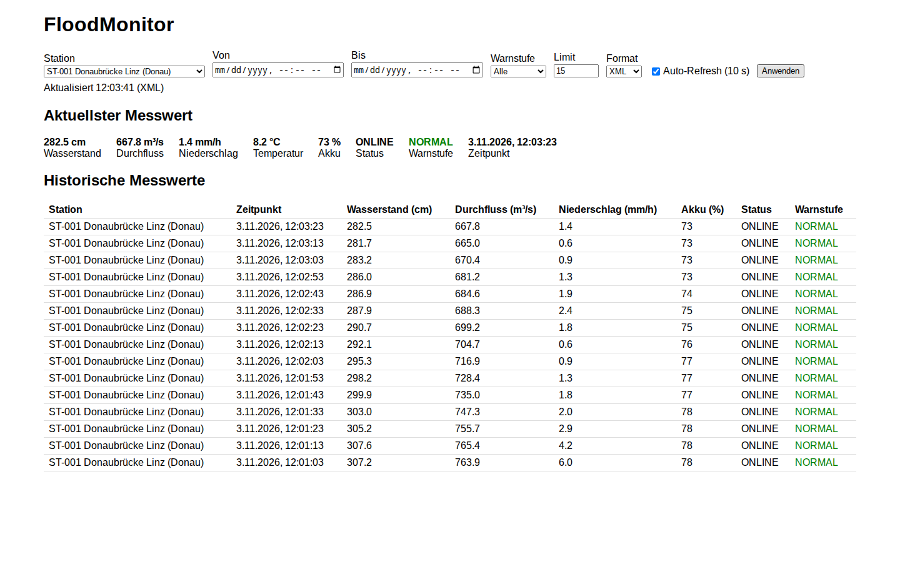
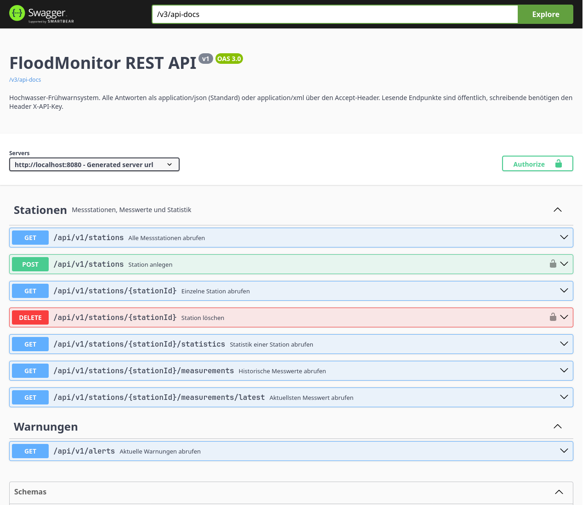

# DEZSYS_GK71_FLOODMONITOR_REST

REST-Schnittstelle eines Hochwasser-Frühwarnsystems mit Spring Boot. Messstationen erzeugen simulierte Messwerte, die als JSON oder XML abrufbar sind. Ein jQuery-Webclient stellt die Daten dar.

## Start

Voraussetzung: Java 17 oder neuer. Gradle Wrapper ist enthalten.

```bash
./gradlew bootRun
./gradlew test
```

| URL | Inhalt |
|---|---|
| http://localhost:8080/ | Webclient |
| http://localhost:8080/swagger-ui.html | Swagger UI |
| http://localhost:8080/v3/api-docs | OpenAPI (JSON) |
| [docs/openapi.yaml](docs/openapi.yaml) | OpenAPI (exportiert) |

## Konfiguration

`src/main/resources/application.properties`:

```properties
simulation.enabled=true
simulation.interval=10000
simulation.history-size=60
measurement.max-age-seconds=300
api.limit.default=100
api.limit.max=1000
api.key=change-me
```

`api.key` ist ein Platzhalter. Im Betrieb über die Umgebungsvariable `API_KEY` setzen.

## Architektur

```
com.example.floodmonitor
├── model        Station, Location, Measurement, Alert, Statistics, WarningLevel, StationStatus, Listen-Wrapper
├── repository   StationRepository, MeasurementRepository (In-Memory)
├── service      StationService, MeasurementService, AlertService, WarningLevelService,
│                SimulationService, SimulationScheduler
├── controller   StationController, AlertController
├── exception    ApiException, ErrorResponse, GlobalExceptionHandler
└── config       ApiKeyInterceptor, WebConfig, XmlConfig, OpenApiConfig
src/main/resources/static   Webclient (index.html, style.css, app.js)
```

Controller nehmen nur Parameter entgegen und delegieren an Services. Die Fehlerbehandlung erfolgt zentral im `GlobalExceptionHandler`.

## Datenmodell

| Klasse | Felder |
|---|---|
| Station | id, name, river, location, normalWaterLevel, warningWaterLevel, criticalWaterLevel, isActive, status, currentWarningLevel |
| Location | latitude, longitude |
| Measurement | stationId, timestamp (`Instant`), waterLevel (cm), flowRate (m³/s), rainfall (mm/h), temperature (°C), batteryLevel (%), status, warningLevel |
| Alert | stationId, stationName, river, timestamp, waterLevel, warningWaterLevel, criticalWaterLevel, warningLevel |
| Statistics | stationId, from, to, minWaterLevel, maxWaterLevel, avgWaterLevel, avgFlowRate, totalRainfall, measurementCount, warningCount, criticalCount |
| WarningLevel | NORMAL, WARNING, CRITICAL, UNKNOWN |
| StationStatus | ONLINE, MAINTENANCE, OFFLINE |

`status` und `currentWarningLevel` einer Station sind schreibgeschützt und werden serverseitig gesetzt.

Stationen beim Start:

| ID | Name | Fluss | Normal | Warnung | Kritisch | Aktiv |
|---|---|---|---|---|---|---|
| ST-001 | Donaubrücke Linz | Donau | 250 | 400 | 550 | ja |
| ST-002 | Reichsbrücke Wien | Donau | 280 | 450 | 600 | ja |
| ST-003 | Staatsbrücke Salzburg | Salzach | 180 | 260 | 340 | ja |
| ST-004 | Innbrücke Innsbruck | Inn | 200 | 300 | 400 | ja |
| ST-005 | Hauptbrücke Graz | Mur | 150 | 300 | 420 | nein |

## Simulationsregeln

Alle `simulation.interval` ms wird für jede aktive, nicht OFFLINE Station ein Messwert aus dem vorherigen berechnet. Beim Start werden `simulation.history-size` Messwerte rückwirkend erzeugt.

| Größe | Regel |
|---|---|
| Niederschlag | `vorher * 0.7 + max(0, N(0,1))`, mit 3 % Wahrscheinlichkeit zusätzlich Starkregen 10 bis 35 mm/h, begrenzt auf 0 bis 80 |
| Wasserstand | Änderung `(rainfall - 2) * 0.8 - (vorher - normal) * 0.03 + N(0,1)`, begrenzt auf -10 bis +20 cm pro Messung, nie negativ |
| Durchfluss | `0.08 * waterLevel^1.6`, steigt also mit dem Wasserstand |
| Temperatur | `vorher + N(0, 0.3)`, begrenzt auf -25 bis 40 °C |
| Akku | sinkt pro Messung mit 50 % um 1 %, Bereich 0 bis 100 |
| Status | Akku unter 10 % ergibt MAINTENANCE, in der nächsten Messung ist der Akku getauscht (100 %, ONLINE) |

Starkregen hebt den Wasserstand also tendenziell, ohne Regen fließt das Wasser langsam zum Normalwert zurück. In Tests ist die Simulation mit `simulation.enabled=false` abgeschaltet.

## Warnstufen

Die Warnstufe wird nur serverseitig im `WarningLevelService` berechnet.

| Bedingung | Warnstufe |
|---|---|
| waterLevel < warningWaterLevel | NORMAL |
| waterLevel >= warningWaterLevel | WARNING |
| waterLevel >= criticalWaterLevel | CRITICAL |
| Station inaktiv, keine Messung, Messung älter als `measurement.max-age-seconds` oder ungültiger Wert | UNKNOWN |

Niederschlag und Anstiegsgeschwindigkeit werden nicht berücksichtigt.

## Endpunkte

Basis-URL `/api/v1`. Alle Antworten als `application/json` (Standard) oder `application/xml`.

| Methode | Endpunkt | Parameter | Status |
|---|---|---|---|
| GET | /stations | river, isActive, warningLevel | 200, 400 |
| GET | /stations/{stationId} | | 200, 404 |
| GET | /stations/{stationId}/measurements/latest | | 200, 404 |
| GET | /stations/{stationId}/measurements | from, to, limit (1 bis 1000, Standard 100), warningLevel | 200, 400, 404 |
| GET | /stations/{stationId}/statistics | from, to | 200, 400, 404 |
| GET | /alerts | warningLevel, river | 200, 400 |
| POST | /stations | Body Station (JSON oder XML), Header X-API-Key | 201, 400, 401, 403, 409, 415 |
| DELETE | /stations/{stationId} | Header X-API-Key | 204, 401, 403, 404 |

Historische Messwerte sind absteigend nach Zeit sortiert. `/alerts` liefert ohne `warningLevel` alle Stationen mit WARNING oder CRITICAL. In der Statistik zählt `warningCount` Messungen mit WARNING oder CRITICAL, `criticalCount` nur CRITICAL.

Jeder Endpunkt kann zusätzlich 406 (Format nicht unterstützt) und 500 liefern.

## Fehlerformat

```json
{
  "timestamp": "2026-05-01T10:20:00Z",
  "status": 404,
  "error": "Not Found",
  "message": "Station ST-999 wurde nicht gefunden",
  "path": "/api/v1/stations/ST-999"
}
```

Behandelt werden unbekannte Stationen, `from` nach `to`, ungültige Datumsformate, ungültige Warnstufen, `limit` außerhalb 1 bis 1000, ungültige Request-Bodies, fehlende oder falsche API-Keys, doppelte IDs, falsche Medientypen und nicht unterstützte Accept-Header. Stacktraces werden nie ausgegeben. Bei 406 wird der Fehler als JSON geliefert, da das gewünschte Format nicht erzeugt werden kann.

## Sicherheit

Lesende Zugriffe (GET) sind öffentlich. Schreibende Zugriffe benötigen den Header `X-API-Key` (fehlt: 401, falsch: 403), geprüft im `ApiKeyInterceptor` mit zeitkonstantem Vergleich. Eingaben werden validiert, `limit` ist nach oben begrenzt, die Warnstufe kann vom Client nicht gesetzt werden.

## Beispiele

```bash
curl http://localhost:8080/api/v1/stations?river=Donau
curl -H "Accept: application/xml" http://localhost:8080/api/v1/stations/ST-001/measurements/latest
curl "http://localhost:8080/api/v1/stations/ST-001/measurements?from=2026-05-01T08:00:00Z&to=2026-05-01T12:00:00Z&limit=100"
curl "http://localhost:8080/api/v1/alerts?warningLevel=CRITICAL&river=Donau"
curl -X POST -H "X-API-Key: change-me" -H "Content-Type: application/json" \
     -d '{"id":"ST-010","name":"Ennsbrücke","river":"Enns","location":{"latitude":48.2,"longitude":14.5},"normalWaterLevel":100,"warningWaterLevel":200,"criticalWaterLevel":300,"isActive":true}' \
     http://localhost:8080/api/v1/stations
```

JSON (`Accept: application/json`):

```json
{
  "stationId": "ST-001",
  "timestamp": "2026-10-20T11:00:34Z",
  "waterLevel": 331.6,
  "flowRate": 863.0,
  "rainfall": 8.3,
  "temperature": 10.5,
  "batteryLevel": 73,
  "status": "ONLINE",
  "warningLevel": "NORMAL"
}
```

XML (`Accept: application/xml`):

```xml
<?xml version='1.0' encoding='UTF-8'?>
<measurement>
  <stationId>ST-001</stationId>
  <timestamp>2026-10-20T11:00:34Z</timestamp>
  <waterLevel>331.6</waterLevel>
  <flowRate>863.0</flowRate>
  <rainfall>8.3</rainfall>
  <temperature>10.5</temperature>
  <batteryLevel>73</batteryLevel>
  <status>ONLINE</status>
  <warningLevel>NORMAL</warningLevel>
</measurement>
```

Listen werden umschlossen, z.B. `{"stations":[...]}` bzw. `<stations><station>...</station></stations>`.

## Webclient

Der Client unter `/` lädt die Stationen, zeigt den aktuellsten Messwert und die historischen Messwerte als Tabelle, filtert nach Zeitraum, Warnstufe und Limit, schaltet zwischen JSON und XML um (XML wird mit jQuery ausgewertet), aktualisiert alle 10 Sekunden und zeigt Lade- und Fehlermeldungen an. NORMAL ist grün, WARNING orange, CRITICAL rot, UNKNOWN grau.





## Tests

`FloodMonitorApiTest` (MockMvc, Simulation deaktiviert, feste Testdaten) prüft Stationen als JSON und XML, existierende und unbekannte Station, aktuellsten Messwert, Zeitraumfilter, `from` nach `to`, ungültiges Datum, ungültige Warnstufe, NORMAL, WARNING, CRITICAL, nicht unterstütztes Format (406) und das maximale Limit.

## Fragestellungen

Siehe [FRAGESTELLUNGEN.md](FRAGESTELLUNGEN.md).

## Reflexion

Listen wurden in XML zuerst als `<List><item>` serialisiert, daher gibt es Wrapper-Klassen mit eigenen XML-Elementnamen. Das Feld `isActive` wurde von Jackson als `active` ausgegeben und musste per `@JsonProperty` benannt werden. Bei 406 kann Spring den Fehler nicht im angefragten Format liefern, deshalb setzt der Handler den Content-Type fix auf JSON. Ein globaler Default-Content-Type hat den YAML-Export von springdoc gebrochen und wurde entfernt, da Spring Boot JSON ohnehin vor XML reiht. Die erste Version der Simulation ließ den Wasserstand dauerhaft steigen, ein Abflussterm und eine stärkere Rückführung zum Normalwert haben das behoben.
