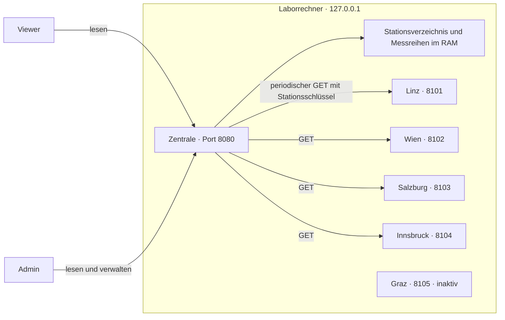

# Sicherheitskonzept und Architekturskizze

## Vertrauensgrenzen

## Rechte und Maßnahmen

| Risiko | Umsetzung |
|---|---|
| Unberechtigtes Lesen | Alle fachlichen REST-Endpunkte verlangen den Header `X-API-Key`. Viewer und Admin dürfen lesen. Webclient und OpenAPI-Beschreibung sind öffentlich zugänglich. |
| Unberechtigte Änderung | Der Server lässt POST und DELETE nur mit Admin-Schlüssel zu. Die Rolle folgt aus dem Schlüssel. |
| Zugriff auf Sensoren | Alle Prozesse binden an IPv4-Loopback. Jeder Sensor prüft `X-Station-Key`. Die Zentrale kontaktiert nur lokal konfigurierte Ports. |
| Offenlegung von Schlüsseln | Drei verschiedene Schlüssel sind zum Start erforderlich. Sie kommen aus der Umgebung oder einer lokalen, von Git ignorierten `.env`. Bei Nutzung der Datei die Rechte auf `600` setzen. Der Webclient hält den Schlüssel im Arbeitsspeicher und lädt seine Skripte lokal. API-Antworten tragen `Cache-Control: no-store`. |
| Verfälschte Zuordnung | Die Zentrale akzeptiert nur Messwerte der erwarteten Stations-ID mit wachsender Zeit und berechnet Warnstufen aus ihren eigenen Schwellenwerten. |
| Ausfall oder große Antwortmengen | Verbindungs- und Lesezeitlimit je Station, Wiederholung im nächsten Zyklus, begrenzter Speicher und begrenzte Seitengröße. |

## Betriebsgrenzen

HTTP ist für diese Einzelplatzübung auf Loopback beschränkt. Die Rollenschlüssel werden pro Rolle geteilt. Einzelne Benutzer sind dadurch nicht identifizierbar. Bei Offenlegung den betroffenen Schlüssel ersetzen und die Prozesse neu starten. Für einen Betrieb über Rechnergrenzen wären TLS und individuelle Zugangsdaten erforderlich.
